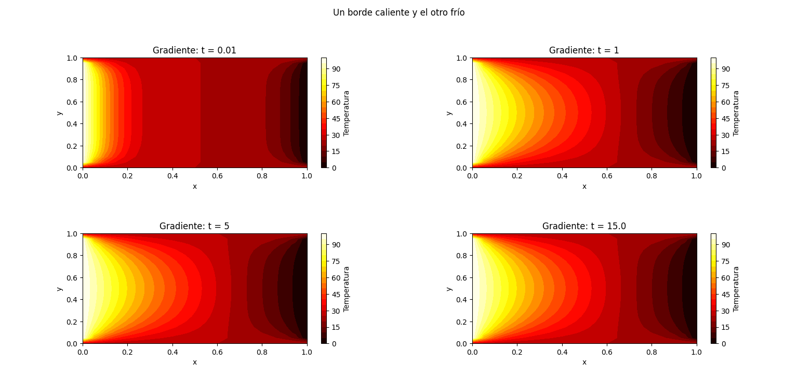

# Resultados y validación

Esta sección presenta los resultados numéricos del proyecto, las gráficas obtenidas, las pruebas de validación y la comparación entre las implementaciones desarrolladas en Python y C++. También se incluye el análisis de convergencia del método FTCS y la interpretación física de los resultados.

## 1. Cómo regenerar los datos

Desde la raíz del repositorio, ejecutar:

```bash
python -m pip install numpy matplotlib
python scripts/validar_calor.py             # unos segundos
python scripts/validar_calor.py --original  # incluye la función original de heat.py (≈1–2 min)
```

El script no modifica `heat.py`, `heat.cpp` ni los CSV originales de C++. Escribe sus resultados en `resultados/`, copia los CSV a `docs/datos/` y las figuras a `docs/img/` para que puedan publicarse en este sitio. Matplotlib es opcional: si no está instalado, se omite la generación de figuras.

El script realiza las siguientes operaciones:

1. Reproduce los dos escenarios de `heat.py` (`M = 20`, `h = 1e-4`, `t_end = 15`, con instantáneas en los tiempos 0.01, 1, 5 y 15) mediante una versión vectorizada de la fórmula FTCS y verifica la estabilidad antes de iterar.
2. Exporta las matrices con el mismo formato que los CSV de C++: `Tiempo, j, i, Temperatura`.
3. Compara nodo a nodo las matrices calculadas en Python con los archivos `resultados_punto.csv` y `resultados_gradiente.csv` de C++.
4. Compara la versión vectorizada con un bucle escalar y verifica que un campo uniforme permanezca constante. Con la opción `--original`, también compara los resultados con la función `heat_ftcs_2D` de `heat.py`.
5. Evalúa la convergencia del método frente a la solución analítica:

\[
u(x,y,t)=\sin(\pi x)\sin(\pi y)e^{-2\pi^2\kappa t}.
\]

## 2. Archivos CSV

Los archivos generados y utilizados para el análisis son los siguientes:

| Archivo | Origen | Contenido |
|---|---|---|
| [resultados_punto.csv](datos/resultados_punto.csv) | `heat.cpp` | Punto caliente central, 4 instantes × 441 nodos |
| [resultados_gradiente.csv](datos/resultados_gradiente.csv) | `heat.cpp` | Borde caliente y borde frío, 4 instantes × 441 nodos |
| [python_punto.csv](datos/python_punto.csv) | `validar_calor.py` | Punto caliente, versión vectorizada |
| [python_gradiente.csv](datos/python_gradiente.csv) | `validar_calor.py` | Gradiente, versión vectorizada |
| [heat_py_punto.csv](datos/heat_py_punto.csv) | `heat.py` mediante `--original` | Punto caliente calculado con la función original de Python |
| [heat_py_gradiente.csv](datos/heat_py_gradiente.csv) | `heat.py` mediante `--original` | Gradiente calculado con la función original de Python |
| [resumen_ftcs.csv](datos/resumen_ftcs.csv) | `validar_calor.py` | Temperatura central, máxima y media nodal por instante |
| [comparacion_cpp.csv](datos/comparacion_cpp.csv) | `validar_calor.py` | Diferencias Python − C++ por escenario e instante |
| [pruebas.csv](datos/pruebas.csv) | `validar_calor.py` | Resultados de las pruebas automáticas |
| [convergencia.csv](datos/convergencia.csv) | `validar_calor.py` | Error máximo y orden estimado por malla |

## 3. Análisis físico y resultados numéricos

### 3.1. Punto caliente central

En este escenario se considera una distribución inicial con un único nodo caliente en el centro de la placa. Debido a la difusión del calor, la temperatura de ese nodo disminuye rápidamente y se aproxima a la temperatura de las fronteras, que permanecen fijas en 25.

### 3.2. Gradiente inicial

En este caso se establecen temperaturas diferentes en los bordes de la placa, con un borde caliente y otro frío. La difusión conduce progresivamente a una distribución estacionaria no uniforme, sostenida por las temperaturas impuestas en las fronteras.

### 3.3. Evolución de la temperatura

Los valores obtenidos en el nodo central y la media nodal para los dos escenarios se muestran en la siguiente tabla:

| Tiempo | Punto: centro | Punto: máximo | Gradiente: centro | Gradiente: media nodal |
|---:|---:|---:|---:|---:|
| 0.01 | 26.526536 | 26.526536 | 25.033626 | 30.657058 |
| 1 | 25.000000 | 25.000000 | 37.500000 | 37.386621 |
| 5 | 25.000000 | 25.000000 | 37.500000 | 37.386621 |
| 15 | 25.000000 | 25.000000 | 37.500000 | 37.386621 |

La media nodal incluye los nodos de frontera; por tanto, no corresponde a una integral de energía con ponderación espacial.

En el caso del punto caliente, el máximo inicial de 100 desciende rápidamente debido a la difusión, hasta aproximarse a 25. En el escenario del gradiente, la temperatura central se aproxima a 37.5 y la distribución evoluciona hacia un estado estacionario no uniforme. Los valores extremos de la matriz permanecen determinados por las temperaturas fijas de las fronteras.

Una consideración importante es que el punto caliente está representado por un único nodo. Al refinar la malla, cambia su extensión física. Por ello, para comparar refinamientos del escenario real sería conveniente utilizar una región caliente de ancho físico fijo.

### 3.4. Resultados publicados con C++

El 13 de noviembre de 2026 se incorporaron al repositorio los archivos [`resultados_punto.csv`](datos/resultados_punto.csv) y [`resultados_gradiente.csv`](datos/resultados_gradiente.csv), mediante el [commit 50693a1](https://github.com/aurodriguezb-sys/Proyecto-fisica-computacional/commit/50693a1ccc0b00f6b8b4b81f16bafd447de81546).

Los valores del nodo central (`j = 10`, `i = 10`) registrados en esos archivos son:

| Tiempo | Punto: centro (C++) | Gradiente: centro (C++) |
|---:|---:|---:|
| 0.01 | 26.5265 | 25.0336 |
| 1 | 25 | 37.5 |
| 5 | 25 | 37.5 |
| 15 | 25 | 37.5 |

Los valores coinciden con las tendencias observadas en Python. Sin embargo, los CSV de C++ escriben los valores con redondeo, por lo que no permiten establecer una tolerancia de comparación más estricta únicamente a partir de estas cifras.

## 4. Validación de las implementaciones

### 4.1. Pruebas automáticas

El validador incluye cinco pruebas para verificar la consistencia de los cálculos:

| Prueba | Error máximo | Tolerancia | Resultado |
|---|---:|---:|---|
| Vectorizado vs. bucle escalar, punto (100 pasos) | 0 | 1e-12 | Aprobada |
| Vectorizado vs. bucle escalar, gradiente (100 pasos) | 0 | 1e-12 | Aprobada |
| Campo uniforme constante (1000 pasos) | 0 | 1e-12 | Aprobada |
| `heat.py` original vs. vectorizado, punto (150 000 pasos) | 0 | 1e-9 | Aprobada |
| `heat.py` original vs. vectorizado, gradiente (150 000 pasos) | 0 | 1e-9 | Aprobada |

Las dos primeras pruebas comparan la versión vectorizada con un bucle escalar equivalente. La tercera verifica que un campo uniforme permanezca constante durante la evolución. Las dos últimas comparan los resultados de la versión vectorizada con los de la función original `heat_ftcs_2D` de `heat.py`.

Las cinco pruebas fueron aprobadas. En particular, la versión vectorizada reproduce las matrices obtenidas mediante la función original de Python, dentro de la tolerancia establecida.

### 4.2. Comparación nodo a nodo entre Python y C++

Se compararon las matrices generadas por Python con los CSV publicados de C++. La diferencia absoluta máxima, incluyendo todos los nodos, es:

| Tiempo | Punto | Gradiente |
|---:|---:|---:|
| 0.01 | 4.853e-5 | 75 |
| 1 | 2.049e-9 | 75 |
| 5 | 2.110e-12 | 75 |
| 15 | 2.110e-12 | 75 |

Las diferencias del escenario de punto caliente son pequeñas y compatibles con el redondeo de los CSV de C++ a seis cifras significativas.

En el escenario de gradiente se identifica una discrepancia localizada de 75 unidades en la esquina inferior izquierda (`j = 20`, `i = 0`). En esa posición, Python asigna una temperatura de 25, mientras que C++ asigna 100.

La diferencia se debe al orden de las asignaciones de las condiciones de frontera: en C++ se asignan los cuatro bordes dentro de un mismo bucle, por lo que el orden de las operaciones determina el valor final de la esquina.

Exceptuando esa esquina, las diferencias entre ambas implementaciones son del orden de `5e-5` o menores, compatibles con el redondeo de los archivos CSV. El reporte `comparacion_cpp.csv` registra los 441 nodos por instante, sin nodos faltantes.

La esquina no interviene en el esténcil de cinco puntos utilizado para actualizar los nodos interiores. Por tanto, esta discrepancia no modifica los valores interiores, aunque sí cambia el valor almacenado en la esquina y afecta a la media nodal.

**Este resultado debe considerarse una diferencia pendiente de resolver:** el grupo debe acordar qué valor utilizar en las esquinas y aplicar el mismo criterio en ambas implementaciones.

Las cinco pruebas automáticas anteriores no constituyen una prueba de aprobación de la comparación Python/C++. El validador registra la discrepancia, pero no la clasifica como una prueba superada.

## 5. Análisis de convergencia

Para estudiar la convergencia se considera el cuadrado unitario, con fronteras iguales a cero, difusividad térmica \(\kappa = 1\) y condición inicial:

```math
u_0(x,y)=\sin(\pi x)\sin(\pi y)
```

La solución analítica es:

```math
u(x,y,t)=\sin(\pi x)\sin(\pi y)e^{-2\pi^2t}
```

Se calcula el error máximo nodal en \(t = 0.1\), utilizando un paso temporal aproximado de:

```math
\Delta t \approx 0.2\,\Delta x^2
```

ajustado para alcanzar exactamente el tiempo final. El orden de convergencia se estima mediante:

```math
p=\log_2\left(\frac{E_M}{E_{2M}}\right)
```

donde \(E_M\) representa el error máximo para una malla de resolución \(M\).

Los resultados obtenidos son:

| M | Error máximo | Orden estimado |
|---:|---:|---:|
| 10 | 3.182480e-3 | — |
| 20 | 7.908840e-4 | 2.0086 |
| 40 | 1.974277e-4 | 2.0021 |
| 80 | 4.933862e-5 | 2.0005 |


El orden estimado tiende a 2 al refinar la malla. Este comportamiento es consistente con el esquema FTCS cuando el paso temporal se reduce proporcionalmente a \(\Delta x^2\).

Esta prueba verifica el comportamiento del validador para el caso suave definido por la solución analítica. No constituye por sí sola una validación exhaustiva del programa original ni de la implementación en C++.

## 6. Representaciones gráficas

El script `validar_calor.py` genera mapas de temperatura con una escala de colores fija para cada escenario, de manera que los cuatro instantes puedan compararse entre sí.

**Punto caliente central:**


**Borde caliente y borde frío:**


También se conservan las gráficas originales generadas por `heat.py`, en las cuales cada panel utiliza una escala de colores independiente.

**Punto caliente central, gráfica original:**


**Gradiente, gráfica original:**



Las figuras generadas por el validador y los archivos CSV se encuentran en `docs/img/` y `docs/datos/`, respectivamente.
