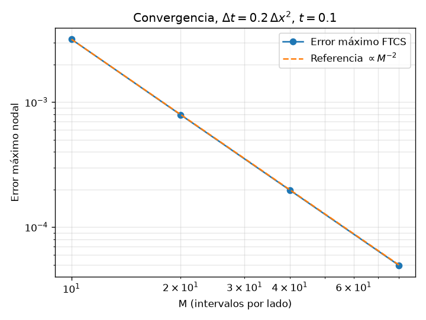
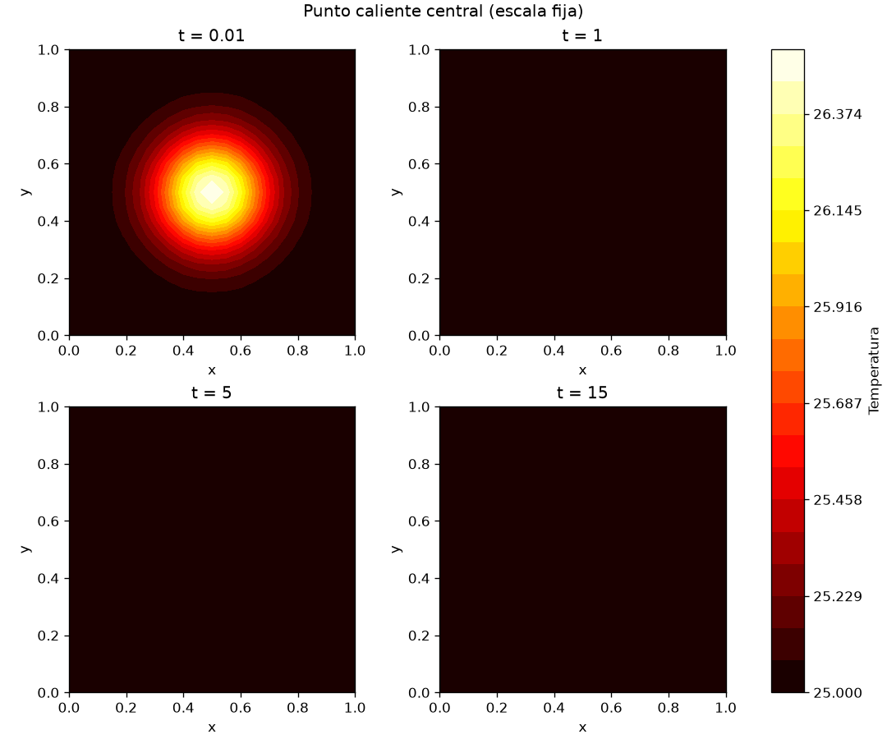
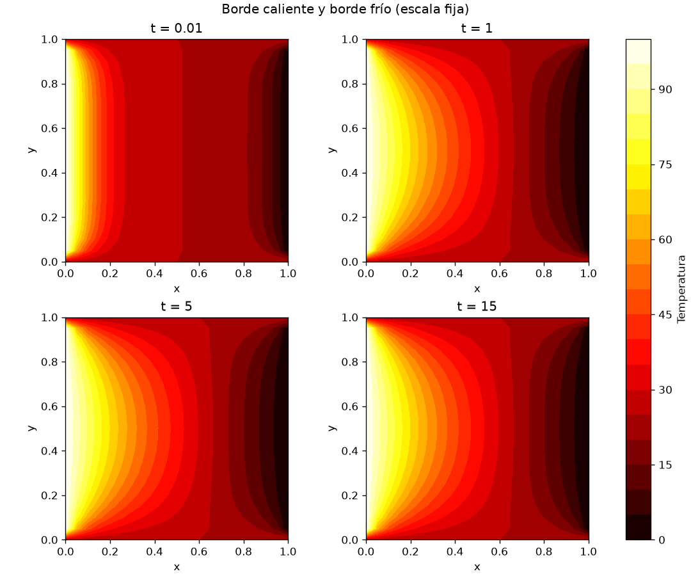
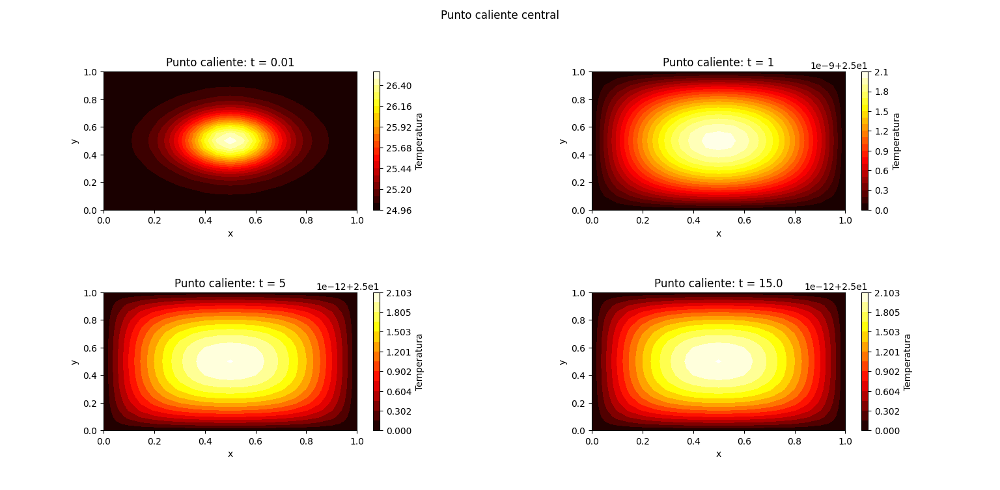

# Datos, gráficas y CSV

Esta página reúne los archivos de datos del proyecto y las salidas del script de validación `scripts/validar_calor.py` (aporte de Samuel Rojas). Los resultados numéricos, la comparación entre implementaciones y las gráficas se documentan en esta página.

## Cómo regenerar los datos

Desde la raíz del repositorio:

```bash
python -m pip install numpy matplotlib
python scripts/validar_calor.py             # unos segundos
python scripts/validar_calor.py --original  # además ejecuta heat_ftcs_2D de heat.py (≈1–2 min)
```

El script no modifica `heat.py`, `heat.cpp` ni los CSV de C++. Escribe sus salidas en `resultados/`, copia los CSV a `docs/datos/` y las figuras a `docs/img/` para que este sitio las publique. Matplotlib es opcional: sin él solo se omiten las figuras.

Qué hace:

1. Reproduce los dos escenarios de `heat.py` (`M = 20`, `h = 1e-4`, `t_end = 15`, tiempos 0.01, 1, 5 y 15) con una versión vectorizada de la misma fórmula FTCS y verifica la estabilidad antes de iterar.
2. Exporta las matrices con el mismo formato que los CSV de C++ (`Tiempo, j, i, Temperatura`).
3. Compara nodo a nodo esas matrices con `resultados_punto.csv` y `resultados_gradiente.csv` de `heat.cpp`.
4. Comprueba la versión vectorizada contra un bucle escalar (100 pasos) y que un campo uniforme permanezca constante. Con `--original` también compara contra la función `heat_ftcs_2D` del propio `heat.py`.
5. Mide la convergencia contra la solución analítica $u = \sin(\pi x)\sin(\pi y)\,e^{-2\pi^2\kappa t}$.

## Archivos CSV

| Archivo | Origen | Contenido |
|---|---|---|
| [resultados_punto.csv](datos/resultados_punto.csv) | `heat.cpp` (Eytan) | Punto caliente central, 4 instantes × 441 nodos |
| [resultados_gradiente.csv](datos/resultados_gradiente.csv) | `heat.cpp` (Eytan) | Borde caliente y borde frío, 4 instantes × 441 nodos |
| [python_punto.csv](datos/python_punto.csv) | `validar_calor.py` | Punto caliente, versión vectorizada, mismo formato que C++ |
| [python_gradiente.csv](datos/python_gradiente.csv) | `validar_calor.py` | Gradiente, versión vectorizada, mismo formato que C++ |
| [heat_py_punto.csv](datos/heat_py_punto.csv) | `heat.py` vía `--original` | Punto caliente calculado con la función original de Python |
| [heat_py_gradiente.csv](datos/heat_py_gradiente.csv) | `heat.py` vía `--original` | Gradiente calculado con la función original de Python |
| [resumen_ftcs.csv](datos/resumen_ftcs.csv) | `validar_calor.py` | Temperatura central, máximo y media nodal por instante |
| [comparacion_cpp.csv](datos/comparacion_cpp.csv) | `validar_calor.py` | Diferencias Python − C++ por escenario e instante |
| [pruebas.csv](datos/pruebas.csv) | `validar_calor.py` | Resultado de las pruebas automáticas |
| [convergencia.csv](datos/convergencia.csv) | `validar_calor.py` | Error máximo y orden estimado por malla |

## Resumen en el nodo central

| Tiempo | Punto: centro | Punto: máximo | Gradiente: centro | Gradiente: media nodal |
|---:|---:|---:|---:|---:|
| 0.01 | 26.526536 | 26.526536 | 25.033626 | 30.657058 |
| 1 | 25.000000 | 25.000000 | 37.500000 | 37.386621 |
| 5 | 25.000000 | 25.000000 | 37.500000 | 37.386621 |
| 15 | 25.000000 | 25.000000 | 37.500000 | 37.386621 |

La media nodal incluye los nodos de frontera; no es una integral de energía ponderada.

## Pruebas automáticas

| Prueba | Error máximo | Tolerancia | Resultado |
|---|---:|---:|---|
| Vectorizado vs. bucle escalar, punto (100 pasos) | 0 | 1e-12 | Aprobada |
| Vectorizado vs. bucle escalar, gradiente (100 pasos) | 0 | 1e-12 | Aprobada |
| Campo uniforme constante (1000 pasos) | 0 | 1e-12 | Aprobada |
| `heat.py` original vs. vectorizado, punto (150 000 pasos) | 0 | 1e-9 | Aprobada |
| `heat.py` original vs. vectorizado, gradiente (150 000 pasos) | 0 | 1e-9 | Aprobada |

La versión vectorizada reproduce exactamente las matrices de `heat.py`, de modo que `python_*.csv` y `heat_py_*.csv` contienen los mismos valores.

## Comparación nodo a nodo con C++

Diferencia absoluta máxima entre la versión Python y los CSV de `heat.cpp`:

| Tiempo | Punto | Gradiente (sin la esquina `j = 20`, `i = 0`) |
|---:|---:|---:|
| 0.01 | 4.9e-5 | 5.0e-5 |
| 1 | 2.0e-9 | 5.0e-5 |
| 5 | 2.1e-12 | 5.0e-5 |
| 15 | 2.1e-12 | 5.0e-5 |

Las diferencias del orden de $10^{-5}$ se explican por el redondeo a 6 cifras significativas con que `heat.cpp` escribe los CSV. **Hallazgo:** en el escenario de gradiente hay una sola diferencia de 75 en la esquina inferior izquierda (`j = 20`, `i = 0`): `heat.py` la deja en `Tm = 25` y `heat.cpp` en `Th = 100`, porque C++ asigna los cuatro bordes dentro del mismo bucle y el orden de las asignaciones cambia el valor de esa esquina. La esquina no interviene en el esténcil de cinco puntos, así que no afecta a ningún nodo interior; solo cambia el valor guardado (y la media nodal). Conviene que el grupo acuerde qué valor usar en las esquinas.

## Convergencia con la solución analítica

Cuadrado unitario, fronteras cero, $\kappa = 1$, $u_0 = \sin(\pi x)\sin(\pi y)$, error máximo nodal a $t = 0.1$ con $\Delta t \approx 0.2\,\Delta x^2$ (ajustado para llegar exactamente al tiempo final). El orden se estima como $\log_2(E_M/E_{2M})$.

| M | Error máximo | Orden estimado |
|---:|---:|---:|
| 10 | 3.18248e-3 | — |
| 20 | 7.90884e-4 | 2.0086 |
| 40 | 1.97428e-4 | 2.0021 |
| 80 | 4.93386e-5 | 2.0005 |



El orden tiende a 2, como se espera de FTCS cuando $\Delta t \propto \Delta x^2$.

## Mapas de temperatura

Figuras generadas por `validar_calor.py` con una escala de colores fija por escenario, para que los cuatro instantes se puedan comparar entre sí:





Gráficas originales de `heat.py` publicadas por el grupo (escala de colores independiente en cada panel):




---

## Análisis físico y validación complementaria de Orlando

> **Alcance del análisis:** la integración del 20 de noviembre aportó pruebas y comparación nodo a nodo. El rendimiento paralelo continúa pendiente de medición.

### 1. Evidencia original

El repositorio contiene `heat.py`, `heat.cpp`, `heat.exe`, dos figuras PNG y dos archivos CSV de resultados de C++ para cuatro instantáneas por escenario. Véanse [punto caliente](https://github.com/aurodriguezb-sys/Proyecto-fisica-computacional/blob/main/grafica_punto_caliente_central.png) y [gradiente](https://github.com/aurodriguezb-sys/Proyecto-fisica-computacional/blob/main/grafica_gradiente.png). Se verifica su presencia en Git; la interpretación física se basa en los códigos y en la reproducción numérica independiente, sin afirmar una inspección visual detallada de los PNG originales.

### 2. Resultados complementarios (ejecutados el 12/11/2026)

El script `scripts/validar_calor.py` implementa la misma fórmula FTCS y las mismas fronteras, con operaciones vectorizadas NumPy. No se ejecutó el `heat.py` completo original ni se midió su rendimiento. Se comparó la fórmula vectorizada con un bucle escalar equivalente durante 100 pasos (tolerancia absoluta 1e-12), y se verificó que un campo uniforme permanece constante. Ambas pruebas pasaron.

| Tiempo | Punto: centro | Gradiente: centro | Gradiente: media nodal |
|---:|---:|---:|---:|
| 0.01 | 26.526536 | 25.033626 | 30.657058 |
| 1 | 25.000000 | 37.500000 | 37.386621 |
| 5 | 25.000000 | 37.500000 | 37.386621 |
| 15 | 25.000000 | 37.500000 | 37.386621 |

Los valores están redondeados. La media nodal incluye bordes; no es una integral de energía con ponderación espacial. En el punto caliente, el máximo inicial de 100 desciende rápidamente por la difusión y las fronteras a 25. En el gradiente, la temperatura se aproxima a un estado estacionario no uniforme, sostenido por temperaturas fijas. Los valores extremos de la matriz permanecen 0 y 100 por las fronteras. La configuración tiene un único nodo caliente, cuya extensión física cambia al refinar la malla; para comparar refinamientos del caso real conviene una mancha de ancho físico fijo.

### 2.1. Resultados publicados con C++ (13/11/2026)

El commit [`50693a1`](https://github.com/aurodriguezb-sys/Proyecto-fisica-computacional/commit/50693a1ccc0b00f6b8b4b81f16bafd447de81546) agregó [`resultados_punto.csv`](https://github.com/aurodriguezb-sys/Proyecto-fisica-computacional/blob/main/resultados_punto.csv) y [`resultados_gradiente.csv`](https://github.com/aurodriguezb-sys/Proyecto-fisica-computacional/blob/main/resultados_gradiente.csv). Los valores del nodo central (`j=10`, `i=10`) registrados en esos archivos son:

| Tiempo | Punto: centro (CSV C++) | Gradiente: centro (CSV C++) |
|---:|---:|---:|
| 0.01 | 26.5265 | 25.0336 |
| 1 | 25 | 37.5 |
| 5 | 25 | 37.5 |
| 15 | 25 | 37.5 |

El CSV utiliza redondeo en la escritura de valores, por lo que no permite inferir a partir de estas cifras una tolerancia de comparación más estricta. El comportamiento coincide con las tendencias descritas en el análisis independiente: relajación hacia 25 en el caso de punto caliente y acercamiento a un estado estacionario no uniforme cuando los bordes tienen temperaturas diferentes. La comparación completa se incorporó en la PR #1; se registró una diferencia localizada de 75 en una esquina del caso de gradiente. Tampoco se dispone de datos verificados de tiempo de cálculo o de aceleración.
### 3. Convergencia con solución analítica

Sobre el cuadrado unitario con fronteras cero y $\kappa=1$, se empleó $u_0=\sin(\pi x)\sin(\pi y)$ y $u(t)=u_0e^{-2\pi^2t}$. Se calculó el error máximo nodal a $t=0.1$, con $\Delta t=0.2\Delta x^2$ (ajustado para coincidir con el tiempo final). El orden estimado es $\log_2(E_M/E_{2M})$.

| M | Error máximo | Orden estimado |
|---:|---:|---:|
| 10 | 3.18248e-3 | — |
| 20 | 7.90884e-4 | 2.0086 |
| 40 | 1.97428e-4 | 2.0021 |
| 80 | 4.93386e-5 | 2.0005 |

Se observa orden cercano a dos con el refinamiento acoplado $\Delta t\propto\Delta x^2$, consistente con FTCS. Esto verifica el script complementario en ese caso suave, no constituye una prueba exhaustiva del programa original ni de la futura implementación C++.

### 4. Pendientes experimentales

Comparar nodo a nodo las salidas reales de Python y C++ bajo idénticos parámetros, con tolerancia definida; generar mapas con una escala fija por escenario; incluir tiempos iniciales y más instantes tempranos; documentar unidades; y probar fronteras Neumann si se desea aislamiento perfecto. Medir tiempo, aceleración y eficiencia de OpenMP para mallas suficientemente grandes. La presencia de `heat.exe` y de CSV no constituye por sí misma una medición de rendimiento.


### 5. Nuevos resultados incorporados con la pull request #1

Desde el [merge `6f363399`](https://github.com/aurodriguezb-sys/Proyecto-fisica-computacional/commit/6f3633991a747fd67dd0bcf6d6dedc773b5460db), el repositorio contiene una página de [datos, figuras y CSV](resultados.md) preparada por Samuel Rojas y un script de validación reproducible en [`scripts/validar_calor.py`](https://github.com/aurodriguezb-sys/Proyecto-fisica-computacional/blob/main/scripts/validar_calor.py). Esta sección añade los resultados posteriores sin sustituir las tablas y observaciones de avance anteriores.

#### 5.1. Pruebas registradas

| Prueba publicada en `resultados/pruebas.csv` | Error máximo | Tolerancia | Estado |
|---|---:|---:|---|
| Escalar frente a vectorizado, punto (100 pasos) | 0 | 1e-12 | Aprobada |
| Escalar frente a vectorizado, gradiente (100 pasos) | 0 | 1e-12 | Aprobada |
| Campo uniforme constante (1000 pasos) | 0 | 1e-12 | Aprobada |
| Python original frente a vectorizado, punto (150 000 pasos) | 0 | 1e-9 | Aprobada |
| Python original frente a vectorizado, gradiente (150 000 pasos) | 0 | 1e-9 | Aprobada |

#### 5.2. Diferencia máxima absoluta de Python respecto de los CSV de C++

| Tiempo | Punto | Gradiente (incluye esquina distinta) |
|---:|---:|---:|
| 0.01 | 4.853e-5 | 75 |
| 1 | 2.049e-9 | 75 |
| 5 | 2.110e-12 | 75 |
| 15 | 2.110e-12 | 75 |

Las diferencias de punto caliente responden a la escritura redondeada del CSV de C++. La diferencia de 75 en `gradiente` se concentra en la esquina `(j=20,i=0)`: 25 en Python, 100 en C++. Exceptuada esa esquina, la concordancia para el resto de la placa es compatible con un error de redondeo de aproximadamente `5e-5` o menor. Todos los 441 nodos por instante están presentes en los archivos comparados, según el reporte `comparacion_cpp.csv` (`nodos_faltantes=0`).

#### 5.3. Convergencia y material gráfico

| M | Error máximo | Orden estimado |
|---:|---:|---:|
| 10 | 3.182480e-3 | — |
| 20 | 7.908840e-4 | 2.0086 |
| 40 | 1.974277e-4 | 2.0021 |
| 80 | 4.933862e-5 | 2.0005 |

La [gráfica de convergencia](img/convergencia.png), el [mapa de punto caliente](img/mapa_punto.png) y el [mapa de gradiente](img/mapa_gradiente.png) se encuentran ahora en `docs/img/`. Las tablas y los archivos originales se encuentran en la carpeta `docs/datos/` del sitio.

**Precaución:** el validador publica la discrepancia con C++, pero las cinco pruebas aprobadas se refieren a equivalencia escalar/vectorizada, campo uniforme y Python original; no incluyen un criterio automático de aprobación para el error C++/Python. Tampoco contienen mediciones de rendimiento de OpenMP.
